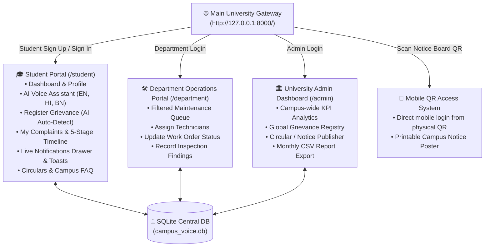

# 🎙️ CampusVoice: University AI Voice Assistant & Grievance Redressal System

An institutional, AI-powered smart campus assistance and grievance management system featuring **role-based portals for Students, Maintenance Departments, and University Administration**.

---

## 🏛️ System Architecture & Role Separation



---

## 🚀 Key Modules & Newly Added Features

### 1. 🎓 Student Sign Up & Secure Login
- **Self-Service Registration:** New students can register directly on the gateway (`/`) with Name, Student ID (Roll Number), Department, Semester, Email, Contact, and Password.
- **Immediate Welcome Alert:** Account registration automatically generates a personalized welcome notification with onboarding guidance.
- **Client & Server Validation:** Validates duplicate Student IDs, email formats, and password requirements before creating credentials.

### 2. 🔔 Real-Time Live Notification System
- **Real-Time Polling & Toast Alerts:** Student portal polls for status updates (`Pending` → `In Progress` → `Resolved`), technician dispatches, and circular broadcasts.
- **Unread Badge & Slide-Over Drawer:** Real-time badge counter on the notification bell opens a clean slide-over drawer with one-click "Mark All as Read" and filter by category.
- **Instant Status Synchronization:** When a department staff updates a ticket status or assigns a technician, the student receives a floating toast alert on their screen.

### 3. 🧠 Working AI Sentiment & Explainable Urgency Scoring
- **Urgency Scoring (0–100):** Transparent multi-factor scoring based on:
  - Safety & Electrical Hazards (+55)
  - Critical Utilities (water, power, sanitation) (+40)
  - Frustrated / Repeated Failures (+25)
  - Time-critical adverbs (+20)
  - Academic & exam disruptions (+20)
- **Sentiment Classification:** Categorized into `Neutral`, `Concerned`, `Frustrated`, or `Urgent`.
- **Explainable Factors Gauge:** The student grievance registration form displays an interactive visual gauge showing exactly *why* an issue was rated high priority.

### 4. 📱 Dynamic Campus QR Code Access System
- **Mobile Access Endpoint:** Live PNG generated on-the-fly (`/api/qr/code`) pointing directly to the campus server address.
- **Printable Notice Board Poster:** Modal button opens an institutional A4 printable poster (`Print Official Poster`) ready to be mounted in hostel lobbies, canteens, and classroom bulletin boards.

### 5. 🎨 Non-"AI-Generated" Institutional ERP Theme
- **Authentic Academic Palette:** Built with university blue (`#1e3a8a`), clean slate background (`#f8fafc`), crisp borders, and accessible typography (Plus Jakarta Sans).
- **Professional Layout:** No dark cyberpunk themes, neon glow, or robot graphics. Looks like a genuine university portal (similar to Ellucian, Canvas, or SAP ERP).

---

## 🔑 Login Credentials & Portals

The main gateway (`/`) manages role authentication and enforces strict route protection:

| Portal | URL | Demo Username | Demo Password | Authorized Role | Features |
|---|---|---|---|---|---|
| **Main Gateway** | `/` | — | — | Public / Gateway | Sign In, Sign Up, 1-Click Demo accounts, and Campus QR poster. |
| **🎓 Student Portal** | `/student` | `student` | `student123` | Student (`Rahul Sharma`) | Voice assistant, register complaints, live notifications, timeline modal. |
| **🛠️ IT Department** | `/department` | `dept_it` | `it123` | Department Staff | Manage IT & Wi-Fi tickets, dispatch network engineers. |
| **🛠️ Maintenance Dept**| `/department` | `dept_maintenance`| `maint123` | Department Staff | Manage classroom equipment, ACs, electrical, plumbing. |
| **🛠️ Hostel Dept** | `/department` | `dept_hostel` | `hostel123` | Department Staff | Manage hostel rooms, water coolers, mess facilities. |
| **🏛️ Admin Portal** | `/admin` | `admin` | `admin123` | Campus Dean / Registrar | Global grievance registry, notice publishing, analytics & CSV export. |

---

## 🚀 How to Run the Project

1. **Start the Server:**
   ```powershell
   python run_server.py
   ```
   *(Or double-click `start_campusvoice.bat` in the root folder).*

2. **Access in Browser:**
   - **Main Gateway & Sign In / Sign Up:** [http://127.0.0.1:8000](http://127.0.0.1:8000)
   - **API Documentation (Swagger UI):** [http://127.0.0.1:8000/docs](http://127.0.0.1:8000/docs)
