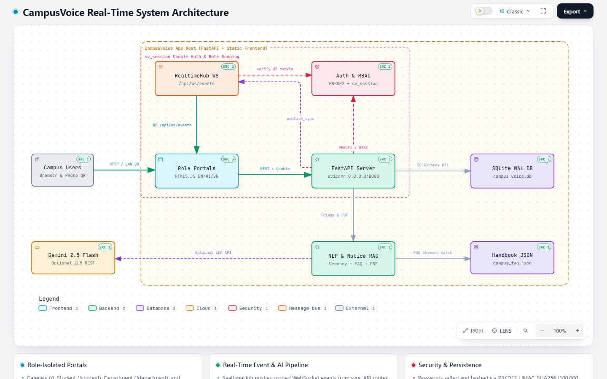
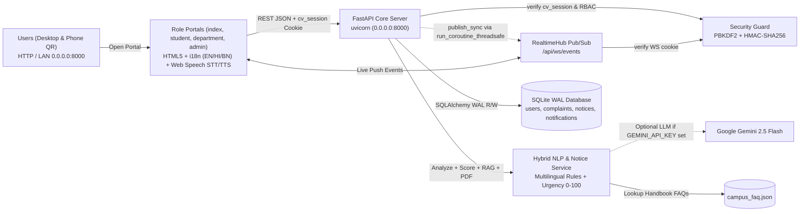

# CampusVoice — Real-Time AI Campus Assistant & Grievance Redressal ERP

CampusVoice is a full-stack, real-time university voice assistant, grievance redressal ERP, and circular broadcast system with strict role-based isolation across **Students**, **Department Staff**, and **University Administration**, full **English / हिंदी (Hindi) / বাংলা (Bengali)** localization, live **WebSocket synchronization**, explainable AI urgency scoring, and **mobile QR standee access**.

---

## In Short (Quick Overview)

- **What it is:** A 3-role campus operations platform (`/` Gateway, `/student`, `/department`, `/admin`) built with **FastAPI**, **SQLAlchemy (SQLite WAL)**, **WebSockets**, **Vanilla ES6 JS + HTML5/CSS3**, **Web Speech API**, and **Hybrid NLP (Gemini 2.5 Flash + deterministic multilingual rules)**.
- **How it flows:** A student speaks or types a complaint (in EN, HI, or BN) or scans a campus QR code -> AI extracts category, location, sentiment, and a `0–100` urgency score -> FastAPI saves the ticket in `campus_voice.db` and pushes an instant WebSocket update to that department's locked queue & the Admin desk -> When a technician is dispatched, the student gets a live toast alert, notification drawer update, and 5-stage timeline refresh without reloading.
- **Security model:** Salted `PBKDF2-HMAC-SHA256` password hashes + `HttpOnly` HMAC-SHA256 `cv_session` cookies guarantee students see only their own complaints/profiles and department staff see only their own department's tickets, while Admins oversee the entire campus.

---

## Architecture Diagrams

### 1. Archify Interactive System Architecture (Validated Repository Diagram)

- **Interactive Explorer (Open in Browser):** [campusvoice-system.html](.archify/architecture-campusvoice-system-20261127-211025/campusvoice-system.html)
- **Visual Overview Capture (Generated by Archify):**



> Tip: Download or open [.archify/architecture-campusvoice-system-20261127-211025/campusvoice-system.html](.archify/architecture-campusvoice-system-20261127-211025/campusvoice-system.html) locally in Chrome/Edge for interactive light/dark mode, guided focal views (*Voice & AI Triage Flow*, *Real-Time WebSocket Push*, *Auth & Role Isolation*), and inspectable code source references.

### 2. High-Level Request & Real-Time Flow (Mermaid)



---

## How the Application Works (Deep Dive)

### 1. Authentication & Strict Role Isolation
- Passwords are stored using **salted PBKDF2-HMAC-SHA256** (`100,000` iterations, 16-byte random salt) in `Minor_Project/backend/app/core/security.py`. Any legacy plaintext records are automatically migrated on startup (`migrate_plaintext_passwords`).
- Signing in (`POST /api/auth/login`) or registering (`POST /api/auth/signup`) issues an **HMAC-SHA256 signed token** stored in an `HttpOnly`, `SameSite=Lax` cookie named `cv_session` (24-hour TTL).
- Single-session & cross-role isolation is enforced on both backend endpoints and `auth.js` (`verifyServerSession`):
  - **Students (`/student`)**: `/api/complaints/`, `/api/complaints/analytics`, `/api/complaints/{ticket_id}`, `/api/notifications/`, and `/api/assistant/process` bind strictly to the authenticated session's `student_id`. Students cannot query or view another student's complaints or profile.
  - **Department Staff (`/department`)**: Operators are locked to their assigned `department_name` (`Maintenance`, `IT/Network`, `Hostel`, `Sanitation`). Switching departments is disabled on the frontend and rejected with `403 Forbidden` on the backend.
  - **Administration (`/admin`)**: University Admins (`admin`) access the campus-wide complaint registry, global KPIs, official circular publisher, and CSV export.

### 2. Multilingual Hybrid AI Triage & Duplicate Detection
- Implemented in `Minor_Project/backend/app/services/nlp_service.py`:
  1. **Language Detection:** Automatically detects Devanagari (`\u0900-\u097F` -> `hi`), Bengali (`\u0980-\u09FF` -> `bn`), or honors the active UI language (`en`, `hi`, `bn`).
  2. **Extraction Engine:** If `GEMINI_API_KEY` is configured in `.env`, calls Gemini 2.5 Flash (`responseMimeType: application/json`) for intent/entity extraction; otherwise (or on API fallback), runs the deterministic multilingual keyword/regex engine (`_rule_based_extraction`).
  3. **Explainable Urgency Scoring (0–100):** Starts at a baseline of `40` and computes transparent additive weights:
     - **Safety / Electrical Hazards** (`fire`, `short circuit`, `spark`, `electric shock`, etc.): `+55` (`Critical`)
     - **Critical Utility Breakdown** (`no water`, `blackout`, `leaking water`, `sewage overflow`, etc.): `+40` (`High`)
     - **Repeated Failure / Frustration** (`again`, `constantly`, `still not fixed`, etc.): `+25`
     - **Urgent Time Adverbs** (`urgent`, `immediately`, `emergency`, `very hot`, etc.): `+20`
     - **Academic / Exam Impact** (`exam`, `viva`, `classroom`, `lecture now`, etc.): `+20`
     - **Routine Minor Item** (`minor`, `dustbin`, `marker`, etc. when score < 60): `-15`
     - Clamped to `[10, 100]` (`>=90 Critical`, `>=70 High`, `>=45 Medium`, `<45 Low`).
  4. **Duplicate Detection (`check_duplicate`):** Matches active tickets (`Pending`, `Assigned`, `In Progress`) in the same category and location with overlapping keywords so technicians aren't flooded with duplicate dispatches.
  5. **Campus Handbook FAQ RAG (`knowledge_service.py`):** Matches user inquiries against `campus_faq.json` with Hindi/Bengali alias expansion (`multilingual_aliases`).

### 3. Real-Time WebSocket Engine (`RealtimeHub`)
- `Minor_Project/backend/app/core/realtime.py` maintains connected authenticated WebSockets indexed with user role, `student_id`, and `department_name`.
- Synchronous FastAPI route threads publish events via `realtime_hub.publish_sync(...)` using `asyncio.run_coroutine_threadsafe` onto the ASGI lifespan event loop:
  - `complaint_created`: Sent to `admin` + matching `department_name` + owning `student_id`.
  - `complaint_updated`: Sent to `admin` + matching `department_name` + owning `student_id` (instantly pops a floating toast and updates open timeline modals & status tables).
  - `notice_published`: Broadcast with `target_student_id="all"` so all online students see new circulars immediately.
  - `notification_sync`: Synchronizes notification read/unread counts across open tabs.
- Frontend clients (`connectRealtimeSocket` in `auth.js`) keep heartbeats (`ping`/`pong` every 25s), reconnect automatically if disconnected (except on `4401` invalid session), and pair with a 20-second background sync fallback.

### 4. Official Circulars, Attachments & PDF 1.4 Generation
- Implemented in `Minor_Project/backend/app/services/notice_service.py` and `notices.py`:
  - Admins can attach real PDF/image/document files (stored as Base64 data + MIME type in `notices`) when publishing circulars.
  - Clicking **Download** (`GET /api/notices/{notice_id}/download`) serves either the uploaded binary attachment or a cleanly formatted PDF generated on the fly by the pure-Python `_build_circular_pdf` generator (no external PDF binary dependencies required).

### 5. Dynamic Campus QR Gateway & LAN Phone Access
- `Minor_Project/run_server.py` binds Uvicorn to `0.0.0.0:8000` so smartphones and other devices on the same Wi-Fi network can reach the server.
- `Minor_Project/backend/app/api/endpoints/qr.py` generates a high-contrast PNG QR code (`border=4` ISO quiet zone, `box_size=10`) pointing to:
  1. Explicit `?url=...` query override (for public domains or HTTPS tunnels), or
  2. `PORTAL_URL` environment variable, or
  3. Non-localhost `Host` header, or
  4. Auto-detected LAN Wi-Fi IP (`http://<LAN_IP>:8000/`).

---

## Tech Stack ("With What Help the App Is Built")

| Layer | Technologies, Libraries & APIs Used | Source Location |
|---|---|---|
| **Web Framework & ASGI** | Python 3, FastAPI (`>=0.110.0`), Uvicorn (`>=0.28.0`), Pydantic v2 (`>=2.6.0`), WebSockets (`>=12.0`) | `Minor_Project/backend/requirements.txt`, `app/main.py` |
| **Database & Persistence** | SQLAlchemy (`>=2.0.28`), SQLite with `PRAGMA journal_mode=WAL` & `busy_timeout=5000` | `Minor_Project/backend/app/core/database.py`, `app/models/` |
| **Authentication & Security** | Python `hashlib.pbkdf2_hmac` (`sha256`, 100k iterations), `hmac` + `base64` signed `cv_session` cookies | `Minor_Project/backend/app/core/security.py`, `services/auth_service.py` |
| **AI / NLP & Knowledge RAG** | Google Gemini 2.5 Flash REST API (`GEMINI_API_KEY` optional via `requests`), custom multilingual keyword/regex triage, `campus_faq.json`, `campus_intents.json` | `services/nlp_service.py`, `services/knowledge_service.py`, `backend/data/` |
| **QR & Document Generation** | `qrcode[pil]` (Pillow PNG generation), built-in Python `socket`, pure-Python PDF 1.4 generator (`_build_circular_pdf`), `csv` module | `api/endpoints/qr.py`, `services/notice_service.py`, `services/complaint_service.py` |
| **Frontend UI & Styling** | Vanilla HTML5, CSS3 custom design system (MedBrief institutional layout), Plus Jakarta Sans + JetBrains Mono fonts, FontAwesome 6.5.1 | `Minor_Project/frontend/style.css`, `*.html` |
| **Frontend State & Audio/Media** | Vanilla ES6 JS, Web Speech API (`SpeechRecognition` / `webkitSpeechRecognition` + `speechSynthesis`), HTML5 `<canvas>` client image compression (avatars + evidence photos), native browser `WebSocket` | `auth.js`, `app.js`, `department.js`, `admin.js`, `i18n.js` |
| **Multilingual Localization** | Custom i18n dictionary (`425` synchronized keys across `en`, `hi`, `bn`) persisted via `localStorage.campusvoice_lang` | `Minor_Project/frontend/i18n.js` |
| **Architecture Visualization** | Archify (`v3.0`) validated HTML + SVG showcase architecture diagram | `.archify/architecture-campusvoice-system-20261127-211025/` |

---

## Database Schema (`campus_voice.db`)

| Table | Purpose | Key Columns |
|---|---|---|
| `users` | Student, Department Staff & Admin accounts | `id`, `username`, `password` (PBKDF2), `full_name`, `role`, `department_name`, `student_id`, `semester`, `email`, `contact`, `avatar_url`, `created_at` |
| `complaints` | Grievances, AI triage metadata, photos & 5-stage timelines | `id`, `ticket_id`, `student_id`, `student_name`, `student_department`, `title`, `issue`, `raw_query`, `category`, `location`, `priority`, `status`, `sentiment`, `urgency_score`, `is_duplicate_of`, `image_url`, `assigned_technician`, `admin_notes`, `timeline_json`, `created_at`, `updated_at` |
| `notices` | Official university circulars & downloadable files | `id`, `title`, `category`, `department`, `content`, `pdf_filename`, `attachment_data`, `attachment_mime`, `is_pinned`, `deadline_date`, `published_date` |
| `notifications` | Real-time per-student and `"all"` broadcast alerts | `id`, `student_id`, `ticket_id`, `title`, `message`, `type`, `is_read`, `created_at` |

---

## API & WebSocket Reference

- Interactive OpenAPI / Swagger UI: `http://127.0.0.1:8000/docs`

| Group | Method & Path | Access | Description |
|---|---|---|---|
| **Auth** | `POST /api/auth/login` | Public | Authenticates credentials (`username`/`student_id`/`email` + password) & sets `cv_session` cookie |
| **Auth** | `POST /api/auth/signup` | Public | Self-registers a new student account & logs into `/student` |
| **Auth** | `GET /api/auth/me` | Authenticated | Validates active session cookie & returns user profile |
| **Auth** | `PATCH /api/auth/profile/avatar` | Authenticated | Uploads/removes profile display photo (Base64 data URL `<= 2MB`) |
| **Auth** | `POST /api/auth/logout` | Public | Clears `cv_session` cookie |
| **AI & FAQ** | `POST /api/assistant/preview` | Public | Read-only gateway voice/text triage & circular preview (zero DB writes) |
| **AI & FAQ** | `POST /api/assistant/process` | Authenticated | Processes voice/text query, creates ticket/emergency or looks up status/FAQ/notice |
| **AI & FAQ** | `GET /api/assistant/faqs` | Public | Returns campus handbook FAQs from `campus_faq.json` |
| **Complaints** | `GET /api/complaints/` | Authenticated | Lists role-scoped complaints (`status`, `category`, `search`, `limit`) |
| **Complaints** | `GET /api/complaints/analytics` | Authenticated | Role-scoped summary counters (`total`, `pending`, `in_progress`, `resolved`, `high_priority`) |
| **Complaints** | `POST /api/complaints/` | Authenticated | Registers a manual grievance with optional compressed photo evidence |
| **Complaints** | `GET /api/complaints/{ticket_id}` | Authenticated | Fetches ticket details & JSON timeline events (ownership enforced) |
| **Complaints** | `PATCH /api/complaints/{ticket_id}/status` | Dept / Admin | Assigns technician, updates status & notes, pushes WS + student notification |
| **Complaints** | `GET /api/complaints/export/csv` | Admin | Downloads `CampusVoice_Complaints.csv` audit export |
| **Notices** | `GET /api/notices/` & `GET /api/notices/{id}` | Public | Lists/fetches university circulars (`category`, `search` filters) |
| **Notices** | `GET /api/notices/{id}/download` | Public | Downloads uploaded file attachment or auto-generated official PDF |
| **Notices** | `POST /api/notices/` | Admin | Publishes a circular (with optional attachment) & broadcasts WS notice |
| **Notifications** | `GET /api/notifications/` | Authenticated | Fetches student's notifications & campus-wide `"all"` broadcasts |
| **Notifications** | `GET /api/notifications/unread-count` | Authenticated | Unread notification count |
| **Notifications** | `PATCH /api/notifications/{id}/read` & `POST /api/notifications/read-all` | Authenticated | Marks notification(s) read and syncs tabs via WS |
| **QR & System** | `GET /api/qr/code` & `GET /api/qr/info` | Public | Generates QR PNG & resolves target portal URL (`?url=` / `PORTAL_URL` / LAN IP) |
| **QR & System** | `GET /api/public/stats` & `GET /api/health` | Public | Live aggregate landing stats and health/WS connection summary |
| **Real-Time** | `WS /api/ws/events` | Authenticated | Bidirectional event stream (`connected`, `ping`/`pong`, live portal pushes) |

---

## Project Directory Structure

```text
Cmpus_Voice-Minor-Project/
├── README.md                              # Complete project documentation & guides
├── run_server.py                          # Root server launcher wrapper
├── start_campusvoice.bat                  # Windows 1-click startup batch script
├── push_to_github.bat                     # Helper GitHub push script
├── .gitignore
├── .archify/
│   └── architecture-campusvoice-system-20261127-211025/
│       ├── candidate.json                 # Validated repository-backed Archify spec
│       ├── campusvoice-system.html        # Standalone interactive SVG architecture diagram
│       └── campusvoice-architecture-preview.png
└── Minor_Project/
    ├── README.md                          # Module quick reference
    ├── run_server.py                      # Uvicorn ASGI runner (0.0.0.0:8000)
    ├── start_campusvoice.bat              # Windows launcher inside Minor_Project
    ├── docs/
    │   └── dataset_guide.md               # Benchmark & 3-tier NLP dataset notes
    ├── backend/
    │   ├── .env.example                   # Optional Gemini / DB / Port config template
    │   ├── requirements.txt               # Python package dependencies
    │   ├── campus_voice.db                # SQLite database (WAL mode)
    │   ├── data/
    │   │   ├── campus_faq.json            # Campus handbook Q&A directory
    │   │   └── datasets/campus_intents.json
    │   └── app/
    │       ├── main.py                    # FastAPI assembly, startup & static routes
    │       ├── core/                      # config.py, database.py, realtime.py, security.py
    │       ├── models/                    # complaint.py, notice.py, notification.py, user.py
    │       ├── schemas/                   # Pydantic request/response contracts
    │       ├── services/                  # auth, complaint, nlp, knowledge, notice, notification
    │       └── api/endpoints/             # auth, assistant, complaints, notices, notifications, qr, ws
    └── frontend/
        ├── index.html                     # Public Gateway, Auth/Signup Modal, Live Preview & QR Standee
        ├── student.html & app.js          # Student Workspace & Multilingual Voice Assistant
        ├── department.html & department.js # Department Staff Work-Order Queue
        ├── admin.html & admin.js          # University Administration & Circular Dashboard
        ├── auth.js                        # Cookie Auth Guard, WebSocket Client & Local Time Formatter
        ├── i18n.js                        # 425-key EN / हिंदी / বাংলা translation engine
        └── style.css                      # Unified MedBrief institutional UI stylesheet
```

---

## How to Install, Run, and Use CampusVoice

### Step 1: Install Prerequisites & Dependencies
- Install **Python 3.10+** (tested on Python 3.12).
- Install Python packages:
  ```bash
  pip install -r Minor_Project/backend/requirements.txt
  ```
- *(Optional)* Configure Gemini AI or custom URLs by copying `Minor_Project/backend/.env.example` to `Minor_Project/backend/.env`:
  ```env
  GEMINI_API_KEY=your_gemini_api_key_here
  DATABASE_URL=sqlite:///./campus_voice.db
  PORTAL_URL=
  ```
  - Without `GEMINI_API_KEY`, CampusVoice runs cleanly using the built-in multilingual rule-based NLP & RAG engine.
  - Set `SEED_SAMPLE_DATA=true` in environment only if starting from a fresh empty DB and you want initial sample tickets populated automatically.

### Step 2: Launch the Server
- **Windows 1-Click:** Double-click `start_campusvoice.bat` in the repository root.
- **CLI (Windows / macOS / Linux):**
  ```bash
  python run_server.py
  ```
- Server opens **`http://127.0.0.1:8000`** in your browser and binds to **`0.0.0.0:8000`** so phones on the same Wi-Fi can connect via LAN IP.

### Step 3: Default Portal Accounts

| Role | Portal URL | Username | Password | Scope |
|---|---|---|---|---|
| **Student** | `/student` | `student` | `student123` | View & manage only own complaints, voice assistant, notices, profile & DP |
| **Student (Self-Registered)** | `/student` | *(Roll No)* | *(Chosen)* | Register any new student via **New Student Registration** on `/` |
| **IT / Network Dept** | `/department` | `dept_it` | `it123` | Locked exclusively to `IT/Network` work orders |
| **Maintenance Dept** | `/department` | `dept_maintenance` | `maint123` | Locked exclusively to `Maintenance` work orders |
| **Hostel Dept** | `/department` | `dept_hostel` | `hostel123` | Locked exclusively to `Hostel` work orders |
| **Sanitation Dept** | `/department` | `dept_sanitation` | `sanitation123` | Locked exclusively to `Sanitation` work orders |
| **University Admin** | `/admin` | `admin` | `admin123` | Campus-wide registry, KPIs, circular publishing & CSV audit export |

> Sign out before switching between different accounts (`auth_signed_in_prefix` warning prevents accidental cross-account access in the same browser).

### Step 4: Using Every Feature Across Portals

#### A. Landing Gateway (`/`)
1. Switch the whole interface instantly using **`EN | हिंदी | বাংলা`** in the top bar.
2. Inspect live database counters (`Active Units`, `SLA Rate / Tickets Handled`).
3. Click **Test Voice Triage** inside the right widget to run read-only live AI scoring and RAG notice lookup without creating a ticket.
4. Click **Campus QR Standee** in the header or footer to display the live scan link (`http://<your-lan-ip>:8000/`), copy the URL, optionally substitute a custom `https://` tunnel URL, or click **Print A4 Notice Standee** for bulletin boards.
5. Sign in under **Student**, **Staff / Dept**, or **Administration**, or open **New Student Registration** to create a fresh student account.

> **Mobile Scanning Note:** Ensure your phone and host laptop are on the same Wi-Fi network (without router client/AP isolation). For mobile Voice Microphone (`SpeechRecognition`), browsers require `localhost` or `https://` — if demonstrating mobile voice on cellular/isolated campus Wi-Fi, paste an `https://` tunnel URL into the QR Standee's custom URL box.

#### B. Student Portal (`/student`)
- **Dashboard Overview:** Live complaint counts (`Total Lodged`, `Pending Triage`, `Resolved Issues`, `College Circulars`), recent complaints, and urgent notices.
- **AI Voice Assistant:** Speak in English, Hindi, or Bengali (via Chrome/Edge mic button) or click any prompt chip / type a message. Toggle spoken TTS voice responses via **Audio Feedback (`ON`/`OFF`)**, automatically register tickets or emergencies (`CVxxxx`), check your own ticket status (`"Status of CV1020"`), or search campus circulars & FAQs.
- **Register Grievance:** Write a problem summary & click **AI Auto-Detect Category & Urgency** to inspect explainable hazard factors (`0–100`), optionally attach a photo (auto-resized via `<canvas>`), and submit directly to the database.
- **My Complaints:** Filter by `All`, `Pending`, `In Progress`, `Resolved`; open any ticket's **View Timeline** modal to track all stage updates and attached evidence photos in real time.
- **College Notices:** Search/filter announcements and download official PDFs or uploaded circulars via **Download**.
- **Campus Handbook & FAQ:** Search campus timings/rules or click **Ask in Voice Assistant →**.
- **Student Profile:** View verified Roll Number, Department, Semester, Email, Contact, and upload or remove your profile display picture (**Upload Photo** / **Remove Photo**).
- **Live Notifications Bell & Toasts:** Slide-over notification drawer syncs via WebSockets whenever a department dispatches a technician or an admin publishes a notice.

#### C. Department Operations Portal (`/department`)
1. Sign in with your department credentials (`dept_it`, `dept_maintenance`, etc.).
2. Your queue header & selector lock strictly to your department (`IT/Network`, `Maintenance`, `Hostel`, `Sanitation`).
3. Observe live `Live Sync` WebSocket badge and real-time toasts as new student grievances arrive.
4. Click **Assign / Update** on a row, inspect any uploaded student evidence photo inside the modal, choose status (`Pending`, `Assigned`, `In Progress`, `Resolved`, `Rejected`), enter technician name & inspection notes, and click **Save & Update Timeline** — pushing the update live to the student and Admin dashboard.

#### D. University Administration Desk (`/admin`)
1. Oversee 5 campus KPI cards (`Total Grievances`, `Pending Triage`, `In Progress`, `Resolved SLA`, `High / Critical`).
2. Search by ticket ID or keyword, filter by Category and Status across all departments, inspect photos, and assign/override work orders.
3. Click **Publish Circular** to post a new notice (optionally attaching a real PDF/image/document) and broadcast an instant notification to all students.
4. Click **Export CSV** to download `CampusVoice_Complaints.csv` for monthly governance audits.
